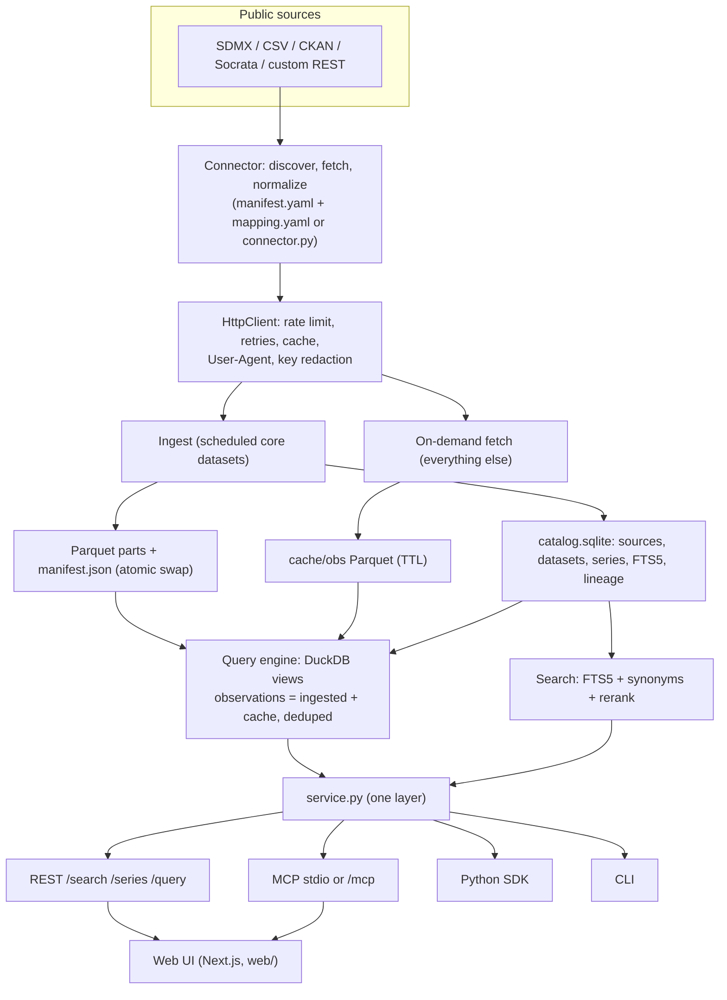

# statmesh

statmesh pulls public statistics from many sources (World Bank, IMF, OECD, ILOSTAT, Eurostat, UN
Comtrade, SEC EDGAR, MoSPI and more) into one catalog and one query layer. You find a series by
searching in plain words, read it through the same SQL, REST, MCP, Python or CLI interface whatever
the source, join it across sources on shared keys (country, year, HS product, company), and every
number comes back with its source, licence and retrieval time. A new source is a folder under
`src/statmesh/connectors/`, often just a YAML file. It runs on one machine: Parquet files, DuckDB
for queries, SQLite for the catalog. It is agent-first: an MCP server is a primary interface, and
the tools tell a model to cite every number and never answer from memory.

Author: Vikash Pathak. Licence: Apache-2.0 for the code (data keeps each source's licence).

## Who it is for

| User | Job |
|---|---|
| Journalists | A number they can check on deadline, with a citation and a chart |
| Students | Find and compare series without learning 33 portals |
| NGO and policy analysts | Join sources on country and year; export a CSV they may redistribute |
| Developers and AI agents | One MCP, REST and SQL interface in place of 33 APIs |

## Status

Version 0.4.0 plus unreleased work (20 Nov 2026). Not deployed: there is no public instance yet, and
the repo is not tagged past v0.2.0. What exists and passes offline checks:

- 33 connectors; REST, SQL, MCP, a Python SDK and a CLI; an opt-in Python sandbox.
- A web UI (`web/`): home, search, series pages with charts and Compare, sources, a SQL workbench,
  chat and an AI sidebar, share links.
- A hosted read-only mirror kit (`deploy/hosted/`), built but never run on Docker.
- A 200-question benchmark on a fixture catalog: 0.895 (main), 0.50 answer rate on the blind hold-out.
  See [Benchmark](#benchmark).
- Live runs so far are in [what has been run](#what-has-been-run). Five keyed sources (bea, census,
  datacommons, eia, fred) and three M3 sources (UNICEF, ABS, INSEE) have only synthetic fixtures. See
  [known gaps](#known-gaps).

New to the codebase, or an AI agent? Start with
[docs/ai-context/00-START-HERE.md](docs/ai-context/00-START-HERE.md). Every doc is indexed in
[docs/README.md](docs/README.md).

## Contents

[Run it locally](#run-it-locally) ·
[Architecture](#architecture) ·
[The connector contract](#the-connector-contract) ·
[Search](#search) ·
[On-demand fetch and the cache](#on-demand-fetch-and-the-cache) ·
[SQL safety](#sql-safety) ·
[MCP](#mcp) ·
[Hosted mode](#hosted-mode) ·
[Web UI](#web-ui) ·
[Configuration](#configuration) ·
[Testing and lint](#testing-and-lint) ·
[Deploy](#deploy) ·
[What has been run](#what-has-been-run) ·
[Benchmark](#benchmark) ·
[Acceptance questions](#the-four-acceptance-questions) ·
[Query surfaces](#query-surfaces-at-a-glance) ·
[Sources](#sources) ·
[Known gaps](#known-gaps) ·
[Contributing](#contributing-a-connector) ·
[Licence](#licence)

## Run it locally

Needs Python 3.12+ and [uv](https://docs.astral.sh/uv/). The web UI also needs Node 20+.
Commands run from the repo root unless a step says `cd web`.

```sh
git clone <this repo> statmesh && cd statmesh
uv sync --extra sdk           # --extra sdk adds pandas/polars for the Python client
cp .env.example .env          # optional: fill in the keys you have (docs/configuration.md)
```

`uv run --env-file .env` loads `.env` for one command; the CLI does not read it on its own. Two
variables matter for a first run:

- `STATMESH_DATA_DIR`: where the catalog and Parquet files go (default `./data`).
- `STATMESH_CONTACT_EMAIL`: SEC EDGAR needs it, so `serve`, `worker` and `mcp` refuse to start
  without it. To skip SEC EDGAR instead, set `STATMESH_DISABLE=sec_edgar`.

### 1. Try it offline in a minute (no network, no keys)

This builds a data directory from the connectors' recorded test fixtures. Most are recorded real
responses, but bea, census, datacommons, eia, fred, unicef, abs and insee use synthetic fixtures
(written by hand from each API's documented shape), and each source is only a small slice.

```sh
export STATMESH_DATA_DIR=$PWD/demo-data STATMESH_DISABLE=sec_edgar
uv run python -c "from statmesh.testing.fixture_catalog import build; build('demo-data')"

uv run statmesh sources --local
uv run statmesh search "unemployment rate India" --local
uv run statmesh sql --local "SELECT geo, period_start, value FROM observations
  WHERE series_id = 'ilostat:DF_UNE_DEAP_SEX_AGE_RT:UNE_DEAP_RT:IND' ORDER BY period_start"
```

`--local` reads the data directory in-process. Without it, the CLI calls a running server at
`STATMESH_URL` (default `http://localhost:8000`).

### 2. Load live data

```sh
export STATMESH_DATA_DIR=$PWD/data
uv run --env-file .env statmesh ingest ilostat     # about 30 s, 38k rows
uv run --env-file .env statmesh sql --local "SELECT geo, period_start, value FROM observations
  WHERE series_id LIKE 'ilostat:DF_UNE_DEAP_SEX_AGE_RT:UNE_DEAP_RT:%'
    AND geo IN ('IND','BGD','VNM') AND freq = 'A' AND period_start >= DATE '2015-01-01'
  ORDER BY geo, period_start"
```

Other keyless sources to start with are `imf`, `oecd`, `eurostat`, `ecb`, `bis` and `worldbank`.
`statmesh discover <source>` lists a source's datasets without loading them. To load a dataset that
is not in the core list, run `statmesh ingest <source> --dataset ID`. `ingest` exits 1 if any
dataset failed.

### 3. Serve REST and MCP

```sh
uv run --env-file .env statmesh serve              # http://127.0.0.1:8000
curl 'http://127.0.0.1:8000/healthz'
curl 'http://127.0.0.1:8000/search?q=unemployment+India&limit=3'
curl -X POST http://127.0.0.1:8000/query -H 'content-type: application/json' \
  -d '{"sql": "SELECT source_id, count(*) AS n FROM observations GROUP BY 1"}'
```

- Interactive API docs: `http://127.0.0.1:8000/docs`.
- MCP over HTTP: `http://127.0.0.1:8000/mcp`.
- MCP over stdio, for Claude Desktop, Claude Code or any other MCP client:

```json
{
  "mcpServers": {
    "statmesh": {
      "command": "uv",
      "args": ["--directory", "/path/to/statmesh", "run", "--env-file", ".env", "statmesh", "mcp"],
      "env": { "STATMESH_DATA_DIR": "/path/to/statmesh/data" }
    }
  }
}
```

Python, with the server running:

```python
from statmesh.sdk import Client

c = Client("http://127.0.0.1:8000")
c.search("CPI inflation India")
c.get("ilostat:DF_UNE_DEAP_SEX_AGE_RT:UNE_DEAP_RT:IND")  # pandas DataFrame
```

### 4. Web UI

With the API from step 3 running:

```sh
cd web
npm install
STATMESH_API_URL=http://127.0.0.1:8000 npm run dev    # http://localhost:3000
```

The pages are home, search, series detail (chart, range presets, Compare), sources, SQL, chat and an
AI sidebar; see [Web UI](#web-ui). Chat asks for your own LLM key (Anthropic, any OpenAI-compatible
endpoint, or Ollama) and talks to the API's `/mcp`. The web app reads `STATMESH_API_URL` (default
`http://localhost:8000`). For a production build, run `npm run build`, then
`node .next/standalone/server.js`. `next start` does not work with this config.

### 5. Run the tests

```sh
uv run pytest -q                   # offline; a few minutes
uv run pytest -q -m live           # calls the real APIs; needs network and keys
uv run ruff check . && uv run ruff format --check .
cd web && npm test && npm run typecheck
```

### With docker compose

```sh
cp .env.example .env
mkdir -p data && sudo chown 1000 data    # the image runs as uid 1000; or: chmod a+rwx data
docker compose up -d                     # api on :8000, worker (scheduler)
docker compose exec api statmesh ingest ilostat
curl 'http://localhost:8000/search?q=unemployment+India'
docker compose --profile web up -d       # optional web UI on :3000
```

Details, including what the worker does and does not schedule: [docs/self-hosting.md](docs/self-hosting.md).

## Architecture



One Python package (`src/statmesh/`) plus the optional web app (`web/`). The connector contract is
the only place a new source touches; everything below it is shared. The service layer
(`service.py`) is the only thing REST, MCP, the SDK and the CLI call, so behaviour is identical on
every surface. Details: [docs/architecture.md](docs/architecture.md) and, for agents,
[docs/ai-context/architecture.md](docs/ai-context/architecture.md).

Storage layout under `STATMESH_DATA_DIR`: `catalog.sqlite`, `manifest.json` (lists the live Parquet
parts, replaced atomically), `obs/<source>/<dataset>/part-*.parquet`, `tables/` (entities and
links), `cache/obs/` (on-demand results), `raw/` (gzipped source responses, kept so a change to
`normalize` can be reprocessed), `shares.sqlite`.

## The connector contract

A source is a folder under `src/statmesh/connectors/<id>/` with a `manifest.yaml` and, depending on
how much code it needs:

| Level | Kind | You write |
|---|---|---|
| 1 | `sdmx`, `ckan`, `socrata` | the manifest only (endpoint, licence, core datasets) |
| 2 | `file` | the manifest plus `mapping.yaml` (CSV/XLSX/zip/gz columns to observations) |
| 3 | `custom` or `rest` | the manifest plus `connector.py` with a `Connector` class |

Every connector offers `discover(http)` (datasets and series for the catalog), `fetch(req, http)`
(raw bytes) and `normalize(chunk)` (pure function to an Arrow table in the observations schema).
All HTTP goes through the shared `HttpClient`; a connector never retries or caches on its own. Every
manifest declares a licence (`name`, `url`, `redistribute: yes|no|review`, `attribution`) and a
rate limit. A shared contract suite (`src/statmesh/testing/contract.py`) runs against recorded
fixtures offline and fails on a `TODO` licence, unmapped geographies above 5%, or a secret in a
fixture. Scaffold with `statmesh connector new <id> --kind {sdmx,file,ckan,socrata,rest,custom}`;
see [docs/connectors.md](docs/connectors.md) and [docs/first-connector.md](docs/first-connector.md).

Observations land in one long table: `series_id` (`source:dataset:indicator:geo`), `geo` (ISO 3166-1
alpha-3, `region:<code>` for aggregates, `IN-XX` for Indian states), `period_start`/`period_end`,
`freq`, `value`, `unit`, `unit_mult`, `dims` (map), `obs_status`, `retrieved_at`, `vintage`. A cross-source
join is a plain SQL join. See [docs/data-model.md](docs/data-model.md).

## Search

Keyword search, no embeddings: SQLite FTS5 (porter stemming) over series titles, descriptions and
synonyms. A query is split into geographies (country names, `G20`, `G7`, `EU27`, "euro area"),
periods ("2023-24", "March 2024", "Q2 2024") and concepts; each concept is expanded with
`src/statmesh/data/synonyms.yaml` ("jobless" to unemployment). Concepts are ANDed; if a question word
the titles never use would hide the headline series, every "all but one concept" query is added; if
nothing matches, any concept is enough. A rerank then reorders (it never filters): more concepts
in the title, series covering the named period, home sources of the geography, titles that lead
with the concept ("Population, total" before "Rural population"), then bm25. Every page is cut from
one fixed pool of 2000 candidates so paging is stable. Search filters: `source`, `geo`, `freq`,
`limit`, `offset` (REST), the same on MCP, the SDK and the CLI.

## On-demand fetch and the cache

The catalog lists everything a connector can discover, but only a curated set of core datasets is
ingested on a schedule. Everything else is fetched when asked: the first request for a `remote`
series (or a series outside a dataset's core list, such as a non-core WHO GHO or World Bank
indicator) calls the connector under a budget (`STATMESH_FETCH_TIMEOUT_S`, `STATMESH_FETCH_MAX_ROWS`,
`STATMESH_FETCH_MAX_WAIT_S`), writes the rows to `cache/obs/` with a TTL (`cache_ttl_days`, default 7)
and answers. A rate-limited source answers `status: rate_limited` with `retry_after` instead of
hanging. SQL sees cached rows too: the `observations` view is the union of ingested and cached rows
with one row kept per row key (ingested first, then latest `retrieved_at`). A row cap that cuts a
fetch or an ingest marks the affected series `partial` (recorded per series under `cut` in
`manifest.json`). On-demand fetch is off in hosted mode.

## SQL safety

`POST /query`, the MCP `run_sql` tool, the SDK, the CLI and the web workbench all run through two
layers. Layer 1 (`query/engine.py`): a DuckDB connection built by trusted code with external access
off (no file or URL reads, no ATTACH/COPY/INSTALL/LOAD), reads limited to the data directories, a
memory limit, and a locked configuration. Layer 2 (`query/sqlsafe.py`): the statement is parsed with
DuckDB's own parser and its syntax tree is walked; exactly one SELECT over the allowlisted views
(`observations`, `observations_vintages`, `series`, `datasets`, `sources`, `entities`, `entity_xref`,
`geos`, `geo_groups`), no table functions, no catalog-reading functions. Results are capped by rows
(`STATMESH_SQL_MAX_ROWS`), bytes (`STATMESH_SQL_MAX_BYTES`) and time (`STATMESH_SQL_TIMEOUT_S`).

## MCP

The server (`statmesh mcp` on stdio, or `/mcp` on the API) offers `search_series`, `describe_series`,
`get_observations`, `run_sql`, `list_sources` and, only when the sandbox is on, `run_python`. Its
instructions tell a model to cite every number, flag any number not found in a tool result, and,
when data is missing, say what it searched, show the three closest series, name the source that
would hold the data, and never answer from memory. Client setups: `statmesh mcp --print-config
{claude-desktop,claude-code,chatgpt}`; steps in [docs/ai-apps.md](docs/ai-apps.md). An agent guide
is served at `/llms.txt` (source: `docs/llms.txt`).

## Hosted mode

`STATMESH_MODE=hosted` turns the API into a public, anonymous, read-only mirror of redistributable
data. The one rule is `can_serve()` in `core/licence.py`: only `redistribute: yes` is served, and the
licence resolves series, then dataset, then source. In hosted mode:

- SQL views, search, series detail, observations and `/sources` all drop non-`yes` data; their
  Parquet files are never attached.
- On-demand fetch is off by default; the Python sandbox is never available; `file://` connectors are refused.
- Every route checks the `Host` header against `STATMESH_ALLOWED_HOSTS` (421 otherwise).
- Defaults tighten: `Cache-Control` 300 s, share cap 262144 bytes, share TTL 90 days.
- `statmesh mirror` ingests only core datasets whose licence is `yes`; the worker skips the rest.
- The deploy kit (`deploy/hosted/`) adds nginx per-IP limits, read-only containers, dropped
  capabilities, an internal API network and split env files (source keys only in the worker's).
  The API is also served under `/v1/` so a ChatGPT Action can import `/v1/openapi.json`.

Design and licence reasoning: [docs/hosted.md](docs/hosted.md); operating it:
[docs/hosted-runbook.md](docs/hosted-runbook.md). Built and unit-tested; not deployed or run on Docker.

## Web UI

`web/` is a Next.js 16 app that talks to the API server-side only (the browser never calls the API).
Pages:

| Page | What it does |
|---|---|
| `/` | Home: featured series, latest updates, browse by source |
| `/search` | Search with source, geography, frequency and topic filters; result cards with a sparkline and the latest value |
| `/series/<id>` | Series detail: the chart is chosen from the series' observed shape (single value, ranked bars, line, multi-line), range presets (1Y, 5Y, 10Y, Max), dimension selects, geography explorer, **Compare** with up to three more series (`?compare=`), table, citations, CSV download. Empty on-demand series are loaded when the page opens (self-host only) |
| `/sources` | Every source with key status, licence, counts and staleness |
| `/sql` | SQL workbench: editor, schema browser, templates, results table and chart, CSV export, and an "Ask" box that writes one SELECT with your own LLM key (self-host only) |
| `/chat` | Chat over the API's MCP tools with your own key (Anthropic, any OpenAI-compatible endpoint, or Ollama); charts, tool-call rows, voice input, a scope bar, and Share |
| AI sidebar | The same chat as a slide-over panel on every page, aware of the page you are on |
| `/a/<id>` | A shared answer, read-only |

Run it with `cd web && npm install && STATMESH_API_URL=http://127.0.0.1:8000 npm run dev`. Structure,
lib modules and hosted-mode behaviour: [docs/ai-context/web.md](docs/ai-context/web.md).

## Configuration

All configuration is environment variables; `.env.example` and `web/.env.example` list them. The
CLI and server do not read `.env` on their own: use `uv run --env-file .env statmesh ...` or docker
compose (`env_file`). Defaults in brackets apply when unset or empty. Full text:
[docs/configuration.md](docs/configuration.md).

| Variable | Default | Meaning |
|---|---|---|
| `STATMESH_DATA_DIR` | `./data` (`/data` in the image) | catalog, Parquet, raw files, caches |
| `STATMESH_MODE` | `self_host` | `self_host` or `hosted` (redistributable data only) |
| `STATMESH_CONTACT_EMAIL` | unset | sent in the User-Agent; `serve`, `worker`, `mcp` refuse to start without it while `sec_edgar` is enabled |
| `STATMESH_DISABLE` | empty | comma-separated source ids to turn off, for example `sec_edgar` |
| `STATMESH_CONNECTORS_DIR` | unset | extra connector folder; overrides a bundled connector with the same id |
| `STATMESH_SQL_TIMEOUT_S` | `20` | SQL timeout, seconds |
| `STATMESH_SQL_MAX_ROWS` | `10000` | row cap for SQL and observations |
| `STATMESH_SQL_MAX_BYTES` | `50000000` | abort a larger SQL result |
| `STATMESH_FETCH_TIMEOUT_S` | `30` | wall-clock budget of one on-demand fetch |
| `STATMESH_FETCH_MAX_ROWS` | `200000` | row cap of one on-demand fetch |
| `STATMESH_FETCH_MAX_WAIT_S` | `5` | longest wait for a rate limit before `rate_limited` |
| `STATMESH_DUCKDB_MEMORY` | `2GB` | DuckDB memory limit (`512MB`, `2GB`) |
| `STATMESH_ONDEMAND` | on; off when hosted | live fetch of non-ingested series |
| `STATMESH_CORS_ORIGINS` | empty | comma-separated allowed origins, or `*` |
| `STATMESH_CACHE_MAX_AGE` | `0`; `300` when hosted | `Cache-Control` max-age, seconds |
| `STATMESH_SHARES` | on | share links on/off |
| `STATMESH_SHARE_MAX_BYTES` | `512000`; `262144` when hosted | largest stored share |
| `STATMESH_SHARE_TTL_DAYS` | `0` (forever); `90` when hosted | share lifetime |
| `STATMESH_EXPORT_MAX_ROWS` | `5000000` | CSV export row cap |
| `STATMESH_PYTHON_SANDBOX` | off | enables `/python` and `run_python`; needs Docker socket (root-equivalent), single-operator machines only; ignored when hosted |
| `STATMESH_ALLOWED_HOSTS` | `localhost:*,127.0.0.1:*,[::1]:*,api:*` | accepted `Host` values for REST and MCP; `*` turns the check off |
| `STATMESH_PUBLIC_URL` | empty | hosted: public origin for the OpenAPI `servers` entry |
| `STATMESH_URL` | `http://localhost:8000` | API the SDK and the CLI (without `--local`) call |
| `STATMESH_BENCH_MODEL` | `claude-sonnet-5-5` | model for `statmesh bench --llm` |
| `STATMESH_EVAL_CATALOG` | unset | CI: fixture catalog for the search-recall test |
| `STATMESH_API_URL` | `http://localhost:8000` | web: base URL of the API (compose: `http://api:8000`) |
| `STATMESH_SITE_URL` | `http://localhost:3000` | web: public origin (sitemap, robots, share links) |
| `STATMESH_ALLOW_SERVER_KEY` | unset | web, hosted only: `1` lets `/chat` use the server's provider keys |
| `ANTHROPIC_API_KEY`, `OPENAI_API_KEY` | unset | web: server-side chat keys (self-host, or hosted with the flag); also `bench --llm` |
| `STATMESH_HTTP_BIND`, `STATMESH_DATA` | `127.0.0.1:8080`, `./data` | `deploy/hosted/compose.yml` only: nginx bind, data volume |

Source API keys (all free; sources marked optional work without one): `FRED_API_KEY` (required),
`BLS_API_KEY` (optional), `COMTRADE_API_KEY` (optional, keyless preview), `DATAGOVIN_API_KEY`
(required), `CENSUS_API_KEY` (required), `BEA_API_KEY` (required), `EIA_API_KEY` (required),
`COMPANIES_HOUSE_API_KEY` (optional), `DATACOMMONS_API_KEY` (required). Never commit a key.

## Testing and lint

```sh
uv run pytest -q                                           # offline (network blocked); a few minutes
uv run pytest -q -m live                                   # real APIs; needs network and keys
uv run ruff check . && uv run ruff format --check .        # line length 100
uv run statmesh bench                                      # 200-question benchmark, gated
uv run statmesh connector test <id>                        # one connector
cd web && npm test && npm run typecheck && npm run lint    # vitest, tsc --noEmit, eslint
```

CI (`.github/workflows/ci.yml`) runs ruff, pytest, builds the fixture catalog, runs the search eval
and `statmesh bench`. A nightly `smoke.yml` runs the live tests and opens one issue per failing
source. Live tests are never a PR check.

## Deploy

- **Self-host with Docker:** `docker compose up -d` runs the API (`:8000`) and the worker on one
  `./data` volume; `--profile web` adds the web UI (`:3000`). See [With docker compose](#with-docker-compose)
  and [docs/self-hosting.md](docs/self-hosting.md).
- **Public mirror:** `deploy/hosted/` (nginx, hardened compose). See [Hosted mode](#hosted-mode).
- **Web on Vercel, API elsewhere:** only `web/` goes to Vercel (Root Directory `web`, Node 22.x); the
  Python API needs a writable disk, so it runs on its own host, and the web app points at it with
  `STATMESH_API_URL`. Set `STATMESH_MODE=hosted` and `STATMESH_SITE_URL` on any public deployment.
  Steps, checklist and rollback: [docs/vercel.md](docs/vercel.md).

## What has been run

Checked on macOS, 20 Nov 2026, except the rows marked 19 Nov, which are carried over from v0.2.0 and
were not repeated:

| Check | Result |
|---|---|
| `uv run --offline pytest -q` (offline) | 1007 passed, 8 skipped, 53 deselected (live); exit 0; about 5 minutes on a busy machine |
| `uv run --offline ruff check .`, `ruff format --check .` | All checks passed; 252 files already formatted |
| web `npm test`, `npm run typecheck`, `npm run lint` | 245 tests in 27 files pass; tsc and eslint clean |
| `statmesh bench` (fixture catalog, 200 questions, `--no-write`) | recall@5, answerable, cited and answer rate all 0.895 (threshold 0.80); exit 0 |
| `statmesh --version` | `statmesh 0.4.0` |
| `statmesh doctor --offline`, `statmesh mirror --dry-run`, `statmesh mcp --print-config claude-desktop`, `bash docs/pilots/demo.sh` | run at v0.4.0 (earlier on 20 Nov): doctor lists 33 sources; mirror would ingest 14 datasets and skip 8 as `review`; config is valid JSON; demo 24 questions, 340 rows, 0 failed. Not repeated after the later web and search changes |
| 19 Nov: offline demo (step 1): `sources`, `search`, `sql` | works |
| 19 Nov: live `ingest ilostat` and the Q1 query | 38,144 rows in 31 s; annual 2015–2025 for IND, BGD, VNM |
| 19 Nov: live `ingest worldbank` | discover worked (1,498 series); the data call timed out on the World Bank side (its `/v2/country/.../indicator` endpoint did not answer within 40 s, while `/v2/indicator` answered in 0.2 s) |
| 19 Nov: `serve`: `/healthz`, `/search`, `/query`, `/series/...`, `/docs`, `/mcp` initialize | works |
| 19 Nov: `statmesh mcp` (stdio), CLI against the server | works |
| 19 Nov: web UI build plus search, series, sources, SQL and chat pages | pages render with demo data (the web UI has changed a lot since; a webpack build was used for verification because Turbopack panics in the build sandbox) |
| Docker image, docker compose, nginx, the hosted deploy kit, the Python sandbox | not run (no Docker daemon) |
| Live calls for keyed sources (FRED, BLS, Census, BEA, EIA, Comtrade, …), `statmesh doctor` live | not run |
| Chat with a real LLM, voice capture, `statmesh bench --llm` | not run |
| Share links and CSV export against a running server | covered by the pytest suite only |
| Claude Desktop, Claude Code, ChatGPT setups | not run in the real apps |

## Benchmark

`statmesh bench` runs 200 questions (`evals/benchmark.yaml`) against a catalog built from the
connectors' recorded fixtures (the "fixture catalog"), so it tests the plumbing, not real coverage.
Per question it searches with the question text and checks four things: **recall@5** (an expected
series is in the top 5), **answerable** (that series returns a value in the asked window for that
geography), **cited** (the result carries a licence, a source URL and `retrieved_at`) and **answer
rate** (all three). The expected keys were read from fixture data, never copied from search output.

| Set | Questions | Score |
|---|---|---|
| Main (`evals/benchmark.yaml`) | 200 | 0.895 on recall@5, answerable, cited and answer rate (CI gate: 0.80); Population topic 0.909 |
| Hold-out 1 (`evals/holdout.yaml`) | 30 | 0.867 answer rate, but it was seen during tuning, so not an unbiased estimate |
| **Blind hold-out 2 (`evals/holdout2.yaml`)** | 30 | **answer rate 0.50** (recall@5 0.667, answerable 0.500, cited 0.533). Written after the search changes, scored once. This is the honest score |

Read the main score as the ceiling and the blind score as the truth. The author tuned search on the
main set, and an earlier 0.91 fell to 0.86 when benchmark-only tuning was removed after review. Rules:
never edit expected keys, thresholds or hold-out answers to raise a score, and do not tune on
hold-out 2 (the next blind set must be new questions). Misses by topic in hold-out 2: Health 5 of 6,
Companies 2 of 2, Population 3 of 7. `--llm` grading (an LLM answers each question using the tools)
has not been run. Flags, the data-directory marker, and hold-out handling:
[docs/benchmark.md](docs/benchmark.md). The checked-in `evals/results/results.json` may lag the
code; run `uv run statmesh bench` for the current number.

## Share links

A Share button under each chat answer creates a public read-only link `/a/<id>` (`POST /shares`,
`GET /shares/{id}`). Stored answers are size-capped and rejected if they look like they hold an API
key; citations are rebuilt from the catalog. The numbers come from the sharer's session and can be
forged, and the page says so. See [docs/sharing.md](docs/sharing.md).

## statmesh doctor

`statmesh doctor [--offline] [--source ID] [--json]` lists each source's key status and, unless
`--offline`, replays one live request per source. Only `--offline` has been run.

## The four acceptance questions

The v1 spec set these as end-to-end tests (`tests/acceptance/`, offline, through REST and MCP).
Below, each one is a set of commands that work with today's CLI. "Run on fixtures" means I ran the
command against a data directory built from the connectors' recorded test fixtures
(`python -m statmesh.testing.fixture_catalog`) with `--local`; it does not mean the live API was
called. "Not run live" applies to every block: no live ingest or fetch was done for this page.

Run the lines as `uv run --env-file .env statmesh ...`, or `docker compose exec api statmesh ...`.
Add `--local` to read `./data` in-process without a server.

### Q1. Unemployment rate, India, Bangladesh, Vietnam, 2015 to latest

Source: ILOSTAT (annual, total sex, 15+).

```sh
statmesh ingest ilostat          # core dataset DF_UNE_DEAP_SEX_AGE_RT
statmesh sql "
  SELECT series_id, geo, period_start, value, unit
  FROM observations
  WHERE series_id LIKE 'ilostat:DF_UNE_DEAP_SEX_AGE_RT:UNE_DEAP_RT:%'
    AND geo IN ('IND','BGD','VNM') AND freq = 'A' AND period_start >= DATE '2015-01-01'
  ORDER BY geo, period_start"
```

Run live: yes (19 Nov 2026; annual 2015-2025, some years missing per country). The dataset also has
quarterly rows, hence `freq = 'A'`. Selecting `series_id` is what
attaches series-level citations. For a World Bank cross-check use
`worldbank:WDI:SL.UEM.TOTL.ZS:IND`.

### Q2. India exports to the USA by HS chapter, latest year vs five years earlier

Source: UN Comtrade. Set `COMTRADE_API_KEY`, or you get the keyless preview (500 records per
call). Comtrade is fetched on demand and cached 30 days; it is never ingested on a schedule.

```sh
statmesh get comtrade:HS-A:X:IND --start 2024-01-01 --end 2024-12-31 --filter partner=USA --filter hs=AG2
statmesh get comtrade:HS-A:X:IND --start 2019-01-01 --end 2019-12-31 --filter partner=USA --filter hs=AG2
statmesh sql "
  WITH y AS (
    SELECT dims['hs'] AS hs, year(period_start) AS yr, sum(value) AS usd
    FROM observations
    WHERE series_id = 'comtrade:HS-A:X:IND' AND dims['partner'] = 'USA' AND dims['hs_level'] = '2'
    GROUP BY 1, 2)
  SELECT a.hs, a.usd AS usd_latest, b.usd AS usd_5y_earlier, a.usd - b.usd AS change
  FROM y a JOIN y b ON b.hs = a.hs AND a.yr = 2024 AND b.yr = 2019
  ORDER BY a.usd DESC"
```

Without `--filter partner=...` the partner defaults to `World`. Use the latest year Comtrade has and
five years before it in place of 2024 and 2019. Run on fixtures: yes (HS 85 first). The Comtrade
licence is `redistribute: no`; an export carries a warning in `SOURCES.md`.

### Q3. SEC EDGAR: fastest revenue growth in one SIC industry

Sources: SEC EDGAR XBRL frames (revenue by filer for a calendar year) and the filer list (name, SIC
code). Needs `STATMESH_CONTACT_EMAIL`; SEC wants it in the User-Agent.

```sh
statmesh ingest sec_edgar --dataset entities       # filer list with SIC; ~10k requests at 8/s
for p in CY2023 CY2024; do
  for c in RevenueFromContractWithCustomerExcludingAssessedTax Revenues SalesRevenueNet; do
    statmesh get sec_edgar:frames:$c --filter period=$p --format json > /dev/null
  done
done
statmesh sql "
  WITH f AS (
    SELECT dims['cik'] AS cik, dims['frame'] AS fr, max(value) AS rev
    FROM observations
    WHERE source_id = 'sec_edgar' AND dataset_id = 'frames'
      AND indicator_id IN ('RevenueFromContractWithCustomerExcludingAssessedTax', 'Revenues', 'SalesRevenueNet')
    GROUP BY 1, 2)
  SELECT e.name, e.industry_code, cur.rev AS rev_cy2024, prev.rev AS rev_cy2023,
         cur.rev / prev.rev - 1 AS growth
  FROM f cur JOIN f prev ON prev.cik = cur.cik AND cur.fr = 'CY2024' AND prev.fr = 'CY2023'
  JOIN entities e ON e.entity_id = 'cik:' || cur.cik
  WHERE e.industry_scheme = 'SIC' AND e.industry_code = '7372'
  ORDER BY growth DESC LIMIT 20"
```

Each `get` fetches one revenue tag for one calendar year, so the loop makes six calls; filers differ
in which tag they use. Run on fixtures: the SQL and the `get` with `--filter period=CY2024` (three
filers: Microsoft, Adobe, Oracle). Caveats: frames match facts to the calendar year, so an
off-calendar fiscal year is approximated; a filer that switched tags can appear twice or not at all
(`max(value)` collapses duplicates); `industry_code` is a string. The inferred CIK to LEI links in
`entity_xref` are not used here.

### Q4. CPI inflation vs policy rate, G20, last 10 years

Sources: IMF CPI (SDMX, `redistribute: review`) and BIS policy rates from the direct `bis`
connector (`redistribute: yes`; this replaced DBnomics as the policy-rate source, see
[decisions](#decisions-that-shape-the-source-list)).

```sh
statmesh ingest imf              # core dataset CPI (year-on-year % change and index)
statmesh ingest bis --dataset WS_CBPOL
statmesh sql "
  SELECT c.geo, year(c.period_start) AS yr, c.value AS cpi_yoy_pct, p.rate AS policy_rate_avg
  FROM observations c
  JOIN (SELECT geo, year(period_start) AS y, avg(value) AS rate FROM observations
        WHERE series_id LIKE 'bis:WS_CBPOL:VALUE:%' GROUP BY 1, 2) p
    ON p.geo = c.geo AND p.y = year(c.period_start)
  JOIN geo_groups g ON g.geo = c.geo AND g.group_id = 'G20'
  WHERE c.series_id LIKE 'imf:CPI:CPI._T.YOY_PCH_PA_PT:%' AND c.freq = 'A'
    AND c.period_start >= DATE '2016-01-01'
  ORDER BY c.geo, yr"
```

Run on fixtures: yes. The BIS fixtures were re-recorded to cover 2022-2023, so they overlap the IMF
CPI fixtures, and `tests/acceptance` Q4 passes. BIS reports the euro area as one aggregate (`region:EMU`), so DEU, FRA and ITA have no
policy-rate row.

## Query surfaces at a glance

| Surface | How |
|---|---|
| SQL | views `observations`, `observations_vintages`, `series`, `datasets`, `sources`, `entities`, `entity_xref`, `geos`, `geo_groups`; one SELECT, row, byte and time caps |
| REST | `GET /search`, `GET /series/{id}`, `GET /series/{id}/observations`, `GET /series/{id}/observations.csv` (streamed export), `POST /query`, `GET /sources`, `GET /schema`, `POST /shares`, `GET /shares/{id}`, `GET /llms.txt`, `GET /healthz`; `POST /python` only when the sandbox is on; OpenAPI at `/docs` |
| MCP | `search_series`, `describe_series`, `get_observations`, `run_sql`, `list_sources` (+ `run_python` when on) over stdio (`statmesh mcp`) or HTTP (`/mcp`) |
| Python | `statmesh.sdk.Client` (pandas or polars frames) |
| CLI | `statmesh search / get / sql / sources / export` (also `serve`, `worker`, `mcp`, `discover`, `ingest`, `mirror`, `bench`, `doctor`, `connector`) |

Connector filters (Comtrade `partner`, `hs`; SEC frames `period`) reach the connector on every
surface: REST repeats `filter=key=value`, MCP takes a `filters` object, the SDK takes `get(...,
filters={...})`, the CLI takes `--filter key=value`. Limits: search `limit` at most 100,
observations `limit` at most 10000, SQL results capped by rows, bytes and time. See
[docs/query-surfaces.md](docs/query-surfaces.md).

## Sources

All 33 folders under `src/statmesh/connectors/`. "Key" is the environment variable the connector
reads. "Redistribute" is the manifest's `licence.redistribute` (`yes`, `no`, `review`); in `hosted`
mode only `yes` is served, and a dataset or series can override the source (series, then dataset,
then source). Kinds: `sdmx`, `file`, `ckan`, `socrata` are config-only (YAML); `custom` has a
`connector.py`. "Fixtures" says whether the recorded test responses came from the real API (real) or
were written by hand from the documented shape (synthetic), because no key was available.

| Source (id) | What | Key | Licence | Redistribute | Kind | Fixtures |
|---|---|---|---|---|---|---|
| World Bank (`worldbank`) | ~16k development indicators, annual | none | CC BY 4.0 | yes | custom | real |
| Our World in Data (`owid`) | 22 curated health charts (WHO/UN based: deaths from alcohol, snakebite, road traffic, suicide, malaria, ...), annual | none | CC BY 4.0 (IHME-based charts: no) | review | custom | real |
| IMF (`imf`) | CPI dataflow ingested, more catalogued | none | IMF Terms of Use, attribution | review | sdmx | real |
| OECD (`oecd`) | prices (CPI); 60 downloads/hour | none | OECD terms (CC BY 4.0 unless a dataset says otherwise) | review | sdmx | real |
| ILOSTAT (`ilostat`) | labour: unemployment, employment, wages | none | CC BY 4.0 | yes | sdmx | real |
| Eurostat (`eurostat`) | EU statistics; annual unemployment ingested | none | CC BY 4.0 | yes | sdmx | real |
| ECB (`ecb`) | HICP inflation (`ICP`), key interest rates (`FM`) | none | ESCB reuse policy | yes | sdmx | real |
| BIS (`bis`) | policy rates (`WS_CBPOL`), credit to the non-financial sector (`WS_TC`) | none | BIS terms of permitted use | yes | sdmx | real |
| UN SDG (`unsdg`) | SDG Global Database (`DF_SDG_GLH`) | none | UNdata terms of use | yes | sdmx | real |
| FAOSTAT (`faostat`) | crops and livestock (`QCL`), trade indicators (`TCLI`), food balances (`FBS`) bulk files | none | CC BY 4.0 | yes | file | real |
| UN Comtrade (`comtrade`) | goods trade by reporter, partner, HS; on demand only | `COMTRADE_API_KEY` (optional: keyless preview) | Comtrade terms | no | custom | real (keyless preview) |
| DBnomics (`dbnomics`) | long-tail macro series; nothing ingested by default | none | per provider | review | custom | real |
| MoSPI eSankhyiki (`mospi`) | India: PLFS, CPI, WPI, IIP, national accounts; three RBI tables (trade, balance of payments, FX) | none | MoSPI Copyright Policy (Category A) | yes (RBI datasets: review) | custom | real |
| data.gov.in (`datagovin`) | catalog of Indian open datasets; observations only for mapped resources | `DATAGOVIN_API_KEY` (required) | GODL-India | yes | custom | synthetic |
| FRED (`fred`) | US and international macro series | `FRED_API_KEY` (required) | per series (copyright tag), default review | review | custom | synthetic |
| BLS (`bls`) | US CPI (`CU`), labour force (`LN`) | `BLS_API_KEY` (optional: v1, 25 queries/day) | US government, cite BLS | yes | custom | v1 real, keyed v2 synthetic |
| SEC EDGAR (`sec_edgar`) | XBRL frames, company concepts, filers (`entities`) | none; `STATMESH_CONTACT_EMAIL` required | US government work | yes | custom | real |
| GLEIF (`gleif`) | LEI records, ISIN and BIC mappings | none | CC0 1.0 | yes | custom | REST real, bulk files partly synthetic |
| UK Companies House (`uk_companies_house`) | register: bulk `snapshot`, REST `company` | `COMPANIES_HOUSE_API_KEY` (optional; REST only) | OGL v3.0 | yes | custom | snapshot real, REST synthetic |
| EU ESEF (`esef`) | filings index (one entity per LEI) and IFRS facts from filings.xbrl.org | none | filings.xbrl.org terms (no restrictions stated) | yes | custom | real |
| US Census (`census`) | ACS 5-year, population estimates (vintages 2019, 2021) | `CENSUS_API_KEY` (required) | US government work | yes | custom | synthetic |
| BEA (`bea`) | NIPA, regional GDP | `BEA_API_KEY` (required) | US government work | yes | custom | synthetic |
| EIA (`eia`) | energy, API v2 | `EIA_API_KEY` (required) | US government work | yes | custom | synthetic |
| Data Commons (`datacommons`) | statistical variables, country and US state | `DATACOMMONS_API_KEY` (required) | CC BY 4.0 compilation; sources keep their own | review | custom | synthetic |
| WHO GHO (`who_gho`) | health indicators, country, yearly (legacy OData API) | none | WHO data policy | review | custom | real |
| CDC Data (`cdc_data`) | data.cdc.gov via Socrata; one dataset mapped | none | US government work | yes | socrata | real |
| Open Canada (`open_canada`) | CKAN portal catalog; one mapped dataset | none | OGL Canada | yes | ckan | real |
| UNICEF (`unicef`) | under-5 mortality (`CME`, UN IGME), total sex and wealth; SDMX | none | UNICEF data terms (not verified) | review | sdmx | synthetic |
| ABS, Australia (`abs`) | quarterly estimated resident population (`ERP_Q`), national persons | none | CC BY 4.0 | yes | sdmx | synthetic |
| INSEE, France (`insee`) | deaths in France, domiciled deaths, annual (`DECES-MORTALITE`); SDMX | none | Licence Ouverte 2.0 (INSEE reuse terms not verified) | review | sdmx | synthetic |
| UNHCR (`unhcr`) | refugees, asylum seekers, IDPs, stateless, by country of asylum; on demand only (no core datasets) | none | UNHCR terms (not verified) | review | custom | real |
| UNESCO UIS (`unesco_uis`) | education and literacy indicators; on demand only (no core datasets) | none | UNESCO UIS terms (not verified) | review | custom | real |
| IBGE SIDRA, Brazil (`ibge`) | estimated resident population (table 6579), national | none | IBGE terms of use (not verified) | review | custom | real |

Socrata and CKAN datasets take the portal's own licence name; if it differs from the manifest's,
that dataset is downgraded to `review`. Any other SDMX endpoint is one more `manifest.yaml`; see
[docs/connectors.md](docs/connectors.md). Per-source licence handling:
[docs/licensing.md](docs/licensing.md).

### Decisions that shape the source list

From [docs/DECISIONS.md](docs/DECISIONS.md) (where it differs from the plan, it wins):

- Folder names `census`, `open_canada` and `cdc_data` replace the planned `datagov_us` and
  `nyc_opendata`. `census` matches `bea` and `eia`; the two planned portals were unreachable or
  broken, and the goal was two sample portals passing the contract suite, not those two.
- BIS is the Q4 policy-rate source. Its first-party terms are verified (cite BIS, no implied
  endorsement, no extra charge in a commercial product), so `bis` is `yes`. DBnomics stays `review`
  because its ODbL covers the database, not each provider's data.
- Census population estimates cover vintages 2019 and 2021 (`pep/population`). Vintage 2023 onward
  moved to `pep/charv` (age, sex and race cells), which is deferred; use ACS `B01003_001E` for
  recent years.
- OECD has no incremental refresh (`updatedAfter` returns 403 on their side): a weekly full
  refresh, with at most 5 core dataflows.
- MoSPI is `yes` for the NSO datasets and `review` for RBI tables. The reading of the Hindi
  copyright page was not independently checked.

## Known gaps

From the spec:

- Indian company financials: MCA data is not freely available in bulk; BSE/NSE disclosures need a
  terms check first.
- Market prices (stocks, intraday FX, commodities): no open source; out of scope.
- Full trade history at HS 6-digit: the free Comtrade tier is too small to mirror, so it is fetched
  per query.
- Survey microdata (for example PLFS unit-level records) and real-time data: out of scope.
- Not built: UK company accounts (iXBRL bulk), a running hosted instance (the kit is built, see
  [docs/hosted.md](docs/hosted.md)), embeddings for search, S3 storage, a Postgres catalog.

### Not built in M3

These were planned for M3 and are not in the tree. Each row gives the reason it was left out.

| Planned source (id) | Why not built |
|---|---|
| UN World Population Prospects (`un_wpp`) | no verified download URL |
| World Bank Poverty and Inequality Platform (`wb_pip`) | the PIP licence is a World Bank research licence, not CC BY; the endpoint returned 500 |
| ONS, UK (`ons`) | no verified CSV endpoint |
| WHO Mortality Database (`who_mortality`) | no verified URL or ICD list |
| Statistics Canada (`statcan`) | its API is not SDMX |
| ISTAT, Italy (`istat`) | host unreachable from the build sandbox |
| IMF World Economic Outlook | dataflow ids and endpoint not confirmed; TLS errors in the build sandbox |
| Eurostat causes of death and energy | dataflow ids and endpoints not confirmed; TLS errors in the build sandbox |
| OECD Health dataflows | dataflow ids and endpoints not confirmed; TLS errors in the build sandbox |
| NASA GISTEMP (`nasa_gistemp`) | robots.txt on the host forbids the data files, and statmesh honours robots.txt; the alternative is Our World in Data's temperature charts (not checked in this repo; the `owid` connector lists none yet) |
| NOAA GML (`noaa_gml`) | robots.txt on the host forbids the data files, and statmesh honours robots.txt; Our World in Data publishes CO2 charts, but the `owid` connector lists none yet |

In what is built:

- FAOSTAT: the full trade matrix (`TCL`) is skipped because of its size; the trade indicators file
  (`TCLI`) is used instead.
- ECB: the exchange-rate dataflow (`EXR`) is not included; only `ICP` and `FM`.
- WHO GHO: built on the legacy OData host. WHO announced a replacement "Data Hub" OData API that was
  not live when the connector was written; the connector will need a port when it is.
- M3 sources: the licence terms of UNICEF, INSEE, UNHCR, UNESCO UIS and IBGE are unverified (all
  `review`). UNICEF, ABS and INSEE have synthetic fixtures with invented values until they are
  re-recorded live. UNHCR and UNESCO UIS have no core datasets because their fetch needs a
  geography.
- Synthetic fixtures only until keys exist: Data Commons, BEA, EIA, FRED, data.gov.in, Census, the
  Companies House REST dataset and BLS's keyed (v2) path. No live smoke test has run for these.
- Keys that need an activation step before they work (BLS, Census): not tested. A bad Census key
  answers with an HTML page, not an error code.
- Census vintage 2021 population variable (`POP_2021`) is from the docs, not a live call.
- FRED licence mapping from copyright tags was written from memory and is unverified against live
  `/fred/series/tags`.
- Sandboxed Python is tested with a fake process, not against a real Docker daemon.
- The web chat page is tested with a stubbed LLM only; it has not been run against a live model.
- Search recall is measured on a fixture catalog, not on a fully ingested one.
- Inferred CIK/UK-number to LEI links use exact normalised names plus location; they are guesses
  with a `confidence` and `inferred = true`, not an official mapping.

## Contributing a connector

Scaffold one with `statmesh connector new <id> --kind {sdmx,file,ckan,socrata,rest,custom}`. The
`ckan` and `socrata` kinds have scaffolds too. Until the licence name, URL and attribution are filled
in, the contract suite fails on `test_licence_has_no_todo` and skips the rest. Walk through
[docs/first-connector.md](docs/first-connector.md), and use the new-source issue template and the
pull request template in `.github/`. Default to `redistribute: review` until you have read the
terms. [CONTRIBUTING.md](CONTRIBUTING.md) has the checks a PR must pass.

## Use with Claude and ChatGPT

`statmesh mcp --print-config claude-desktop`, `claude-code` and `chatgpt --url https://<host>/mcp`
print the setup for your checkout. The steps are in [docs/ai-apps.md](docs/ai-apps.md). None of these
setups has been run in the real apps yet.

For the hosted ChatGPT GPT Action, import `https://<host>/v1/openapi.json`. The `/v1/` prefix comes
from the hosted proxy, which strips it before the API; the API itself serves `/openapi.json`, so a
self-hosted API you reach directly uses `https://<host>/openapi.json`. `--print-config chatgpt`
prints the second form, so on the hosted mirror use the `/v1/` form instead. The agent guide is at
`/v1/llms.txt` on the hosted mirror.

## Pilots and funding

Pilot briefs, the feedback form and a demo script are in [docs/pilots/](docs/pilots/). Funding
drafts are in [docs/funding/](docs/funding/); the drafts there are marked DRAFT, NOT SENT. Nothing in
either folder has been sent. The pilot briefs are not yet marked as drafts.

## Documentation

Index of every doc with a one-line description: [docs/README.md](docs/README.md). The ones to know:

- [docs/ai-context/](docs/ai-context/00-START-HERE.md): the "read this first" folder for AI agents
  (orientation, architecture, web app, decisions, status and gaps, runbook).
- [docs/architecture.md](docs/architecture.md), [docs/data-model.md](docs/data-model.md),
  [docs/connectors.md](docs/connectors.md), [docs/query-surfaces.md](docs/query-surfaces.md)
- [docs/configuration.md](docs/configuration.md), [docs/self-hosting.md](docs/self-hosting.md),
  [docs/hosted.md](docs/hosted.md), [docs/hosted-runbook.md](docs/hosted-runbook.md),
  [docs/vercel.md](docs/vercel.md)
- [docs/licensing.md](docs/licensing.md), [docs/benchmark.md](docs/benchmark.md),
  [docs/sandbox.md](docs/sandbox.md), [docs/sharing.md](docs/sharing.md)
- [CHANGELOG.md](CHANGELOG.md), [CONTRIBUTING.md](CONTRIBUTING.md)

## Licence

Code: Apache-2.0 (`LICENSE`, `NOTICE`). The data stays under each source's own licence, recorded in
the connector manifest and returned with every result.
