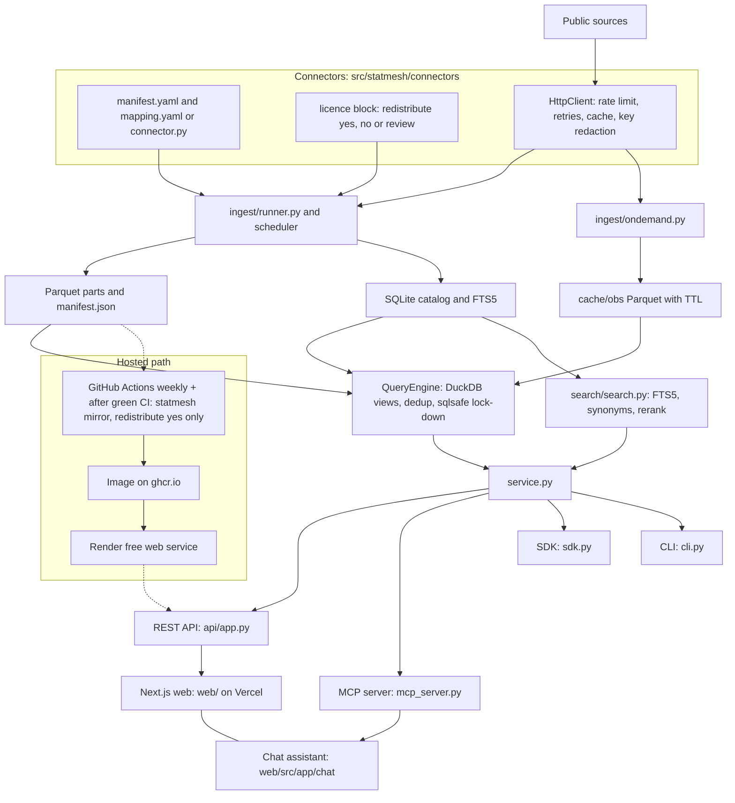
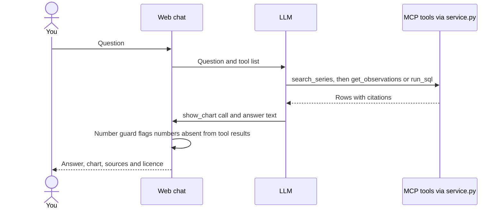

# statmesh

[](https://github.com/pathakvikash/statmesh/actions/workflows/ci.yml)
[](LICENSE)

Public statistics sit behind dozens of portals, each with its own API, units and country codes.
statmesh pulls World Bank, IMF, OECD, ILOSTAT, Eurostat, UN Comtrade, SEC EDGAR, MoSPI (India) and
more into one catalogue and one query layer. You search in plain words, read any series through the
same SQL, REST, MCP, Python or CLI interface, join across sources on country, year, HS product or
company, and every number comes back with its source, licence and retrieval time. A new source is a
folder under `src/statmesh/connectors/`, often only a YAML file. It runs on one machine (Parquet,
DuckDB, SQLite) and is agent-first: the MCP server is a primary interface and tells a model to cite
every number and never answer from memory.

**Try it:** <https://statmesh-ten.vercel.app> (free hosted site, no sign-up).

Limits to know up front. The hosted site is a **subset**: it serves only data whose licence says
`redistribute: yes`, refreshed weekly and after each green CI run on main, read-only. Its API runs on Render's free tier, so the first
request after idle can take tens of seconds (about a minute is quoted in
[docs/hosted-free.md](docs/hosted-free.md); not measured here). Self-hosting gives you everything
you ingest. Search is keyword-based, and the scores in [docs/benchmark.md](docs/benchmark.md) are
measured on a fixture catalogue, not on full coverage.

Author: Vikash Pathak. Version 0.4.0 plus unreleased work ([CHANGELOG.md](CHANGELOG.md)); not on PyPI.

## What you can do

| You want to | Where |
|---|---|
| **Search** for a series in plain words ("unemployment rate India") and filter by source, country, frequency, topic | web `/search`; `GET /search`; `statmesh search` |
| **Chart** a series, compare up to three more, switch range, drill into a country, download CSV | web `/series/<id>` (chart is chosen from the data's shape); Compare via `?compare=` |
| **Write SQL as a beginner**: a guided question builder, India examples, a schema browser, results as table or chart | web `/sql` (guided mode and a full editor) |
| **Ask an AI assistant** and get cited numbers and charts. Bring your own key (Anthropic, OpenAI-compatible, Ollama, LM Studio, OpenRouter), or run a **keyless model in your browser** (WebGPU, one-time download of about 1.6 GB, opt-in) | web `/chat` and the sidebar on every page |
| **Give an AI agent the data** through MCP: `search_series`, `describe_series`, `related_series`, `get_observations`, `run_sql`, `list_sources`, `describe_schema` | `/mcp` on the API, or `statmesh mcp` over stdio; [docs/ai-apps.md](docs/ai-apps.md) |
| **Script it**: REST with OpenAPI, a Python client (pandas or polars), a CLI | `/docs` on the API; `statmesh.sdk.Client`; `statmesh --help`; [docs/query-surfaces.md](docs/query-surfaces.md) |
| **Add a source** | [docs/first-connector.md](docs/first-connector.md) |

The assistant, MCP and REST all return `citations[]`. The chat UI marks any number in an answer
that appears in no tool result. The Claude Desktop, Claude Code and ChatGPT setups have not been
run in the real apps; the chat has been tested against a stubbed LLM in CI, not
benchmarked with a live model (`statmesh bench --llm` has not been run).

## Architecture



- **Connectors** (`src/statmesh/connectors/<id>/`, 34 of them): a `manifest.yaml` with a mandatory
  licence block, plus a `mapping.yaml` or `connector.py` when YAML is not enough. They only call
  `discover`, `fetch` and `normalize`; all HTTP goes through `HttpClient`
  ([core/http.py](src/statmesh/core/http.py)). Guide: [docs/connectors.md](docs/connectors.md).
- **Ingest and storage** ([ingest/runner.py](src/statmesh/ingest/runner.py),
  [core/storage.py](src/statmesh/core/storage.py), [core/catalog.py](src/statmesh/core/catalog.py)):
  core datasets are ingested on a schedule into immutable Parquet parts, listed in one
  `manifest.json` that is swapped atomically, with the catalogue and FTS5 index in SQLite. Everything
  else is fetched on demand and cached with a TTL. Layout: [docs/data-model.md](docs/data-model.md).
- **QueryEngine** ([query/engine.py](src/statmesh/query/engine.py),
  [query/sqlsafe.py](src/statmesh/query/sqlsafe.py)): DuckDB views over the Parquet files. The
  `observations` view merges ingested and cached rows and keeps one row per key. SQL passes two
  layers: a locked-down DuckDB connection and an AST allowlist (one SELECT over named views).
- **service.py** ([source](src/statmesh/service.py)) is the only layer REST, MCP, SDK and CLI call,
  so licence checks, citations and limits behave the same everywhere.
  [docs/architecture.md](docs/architecture.md) has the layers and concurrency rules;
  [docs/ai-context/architecture.md](docs/ai-context/architecture.md) has the per-file detail.
- **Web** ([web/](web/), Next.js 16): server-side only, it calls the API and never exposes it to the
  browser. The assistant reaches the data through the API's `/mcp`. Details:
  [docs/ai-context/web.md](docs/ai-context/web.md).
- **Hosted path** ([.github/workflows/deploy-api.yml](.github/workflows/deploy-api.yml),
  [render.yaml](render.yaml), [Dockerfile.hosted](Dockerfile.hosted)): a workflow (weekly, and after each green
  `ci` on main) runs `statmesh mirror --prune` (only `redistribute: yes` core datasets), builds an image with the data
  baked in, pushes it to ghcr and calls the Render deploy hook. Web on Vercel points at it with
  `STATMESH_API_URL`. See [docs/hosted-free.md](docs/hosted-free.md) and
  [docs/vercel.md](docs/vercel.md).

### What happens when you ask the assistant a question



- **Which LLM** is your choice per request: your own key (kept in the browser), an optional shared
  free model if the operator enables it, or the on-device model. The server's own key is never used
  on a hosted site unless `STATMESH_ALLOW_SERVER_KEY=1`.
  Optional Google sign-in raises your daily allowance on the shared free model.
- **Retrieve via tools**: the route ([chat/api/route.ts](web/src/app/chat/api/route.ts)) connects to
  the API's MCP tools. The prompt says to answer only from tool results and to say what was searched
  when nothing matches.
- **Cited numbers**: each result carries source, licence and retrieved-at; the answer shows a
  sources pill and a Details panel with the SQL and tool rows.
- **Number guard** ([lib/chat/flag.ts](web/src/lib/chat/flag.ts)): a pure check that flags any
  number in the answer that matches no tool result (allowing for rounding and scale words). It
  reduces unsourced numbers; it does not prove an answer correct.
- **Chart**: the `show_chart` tool ([lib/chat/chart.ts](web/src/lib/chat/chart.ts)) draws from
  stored observations, so the model never types chart values. If the model calls no `show_chart`, a
  chart is built automatically from the observations it fetched
  ([lib/chat/auto-chart.ts](web/src/lib/chat/auto-chart.ts)).
- **On-device variant** is retrieval-first with no tool calling: the browser fetches the top five
  series from `/api/chat/context`, the small model answers only from those facts, and the same
  number guard runs. Small models make mistakes; check the sources. See
  [docs/configuration.md](docs/configuration.md).

## Quick start

Needs Python 3.12+, [uv](https://docs.astral.sh/uv/) and, for the web UI, Node 20+ (Node 22 is what
Vercel uses).

```sh
git clone https://github.com/pathakvikash/statmesh.git && cd statmesh
make bootstrap     # uv sync, web npm install, env check (scripts/bootstrap.sh)
make dev           # API on :8000 and web on :3000, on offline demo data; Ctrl-C stops both
```

`make dev` builds `demo-data/` from the connectors' recorded test fixtures on first run (no network,
no keys). Most fixtures are recorded real responses; a few sources use synthetic ones, and each source
is only a small slice. Open <http://localhost:3000>, or use the API directly:

```sh
curl 'http://127.0.0.1:8000/search?q=unemployment+India&limit=3'
```

Without make, from the repo root:

```sh
uv sync --extra sdk
export STATMESH_DATA_DIR=$PWD/demo-data STATMESH_DISABLE=sec_edgar
make demo-data                                   # same as the one-liner in CLAUDE.md
uv run statmesh search "unemployment rate India" --local
uv run statmesh serve                            # REST docs at /docs, MCP at /mcp
cd web && npm install && STATMESH_API_URL=http://127.0.0.1:8000 npm run dev
```

Load real data with `uv run --env-file .env statmesh ingest ilostat` (about 30 s on the author's
machine, 19 Nov 2026); `statmesh discover <source>` refreshes its catalogue first. For MCP
clients, `uv run statmesh mcp --print-config claude-desktop` prints a ready config.
`STATMESH_DISABLE=sec_edgar` skips SEC EDGAR, which otherwise needs `STATMESH_CONTACT_EMAIL`.

Checks: `make check` (lint, tests, web checks), `make test` (offline pytest), `make help` for the
rest. More: [docs/reference.md](docs/reference.md#run-it-locally) (live data, MCP config, Python
client, tests), [docs/self-hosting.md](docs/self-hosting.md) (docker compose),
[docs/configuration.md](docs/configuration.md) (every environment variable).

## Data sources

34 connectors. Examples, by what they cover:

| Area | Sources |
|---|---|
| Macro and development | World Bank, IMF, OECD, BIS, ECB, FRED, Data Commons, DBnomics |
| Labour, trade, food | ILOSTAT, UN Comtrade, FAOSTAT, UN SDG |
| Europe and elsewhere | Eurostat, ABS (Australia), INSEE (France), IBGE (Brazil), Open Canada |
| US | BLS, BEA, Census, EIA, CDC |
| Companies | SEC EDGAR, GLEIF, UK Companies House, EU ESEF |
| Health and people | WHO GHO, UNICEF, UNHCR, UNESCO UIS, Our World in Data |
| **India** | **MoSPI eSankhyiki** (PLFS, CPI, WPI, IIP, national accounts, time use, and more), **DHS Program** (NFHS indicators), **data.gov.in** (catalogue of open datasets) |

India coverage is uneven. MoSPI is the deepest and the only India source in the hosted subset.
DHS has its licence marked `review` because the API's data terms were not found, so the hosted site
does not serve it. data.gov.in needs a free API key and has only synthetic test fixtures so far.
The full table (key, licence, kind, fixture status per source) and the known gaps are in
[docs/reference.md](docs/reference.md#sources).

**Licence rule.** Every manifest declares `redistribute: yes`, `no` or `review`, resolved series,
then dataset, then source; the default is `review`. Hosted mode serves only `yes`; `review` is
treated like `no`. This is the maintainer's reading of public terms, not legal advice, and some
terms are marked unverified in the manifests. Details: [docs/licensing.md](docs/licensing.md). The
code is Apache-2.0; the data keeps each source's own licence.

## Status and honest limits

- Offline checks last recorded as passing on 20 Nov 2026 (pytest, ruff, web tests); the list and
  what was never run are in [docs/reference.md](docs/reference.md#what-has-been-run).
- Benchmark: 0.895 on the 200-question main set, which the author tuned on. The blind hold-out
  answer rate was 0.50 and is the honest number
  ([docs/reference.md](docs/reference.md#benchmark), [docs/benchmark.md](docs/benchmark.md)).
- Several keyed sources (BEA, Census, EIA, FRED, Data Commons, data.gov.in) have only synthetic
  fixtures and no live smoke test.
- The hosted site has no durable store: share links are off there, data is as old as the last mirror
  run, and the Python sandbox and live on-demand fetch are disabled.
- Known gaps (no Indian company financials, no market prices, no microdata) are listed in
  [docs/reference.md](docs/reference.md#known-gaps).

## Project layout

```
src/statmesh/   Python package: core, connectors, ingest, query, search, api, cli, mcp_server, service
web/            Next.js 16 app (search, series, SQL workbench, chat assistant)
tests/          offline pytest suite (pytest-socket blocks the network)
evals/          200-question benchmark, hold-out sets, results
deploy/hosted/  hardened compose and nginx kit for a VM mirror
docker/         container support files; Dockerfile, Dockerfile.hosted, docker-compose.yml, render.yaml at the root
scripts/        dev, bootstrap, check, doctor, smoke helpers (used by the Makefile)
docs/           documentation; index in docs/README.md, detail in docs/reference.md
.github/        CI, deploy-api, deploy-web, nightly smoke, CodeQL, issue and PR templates
```

## Contributing, security, licence

- Start with [CONTRIBUTING.md](CONTRIBUTING.md) and the [code of conduct](CODE_OF_CONDUCT.md);
  project roles are in [GOVERNANCE.md](GOVERNANCE.md). Good first work: a new connector
  ([docs/good-first-sources.md](docs/good-first-sources.md)).
- Report vulnerabilities as described in [SECURITY.md](SECURITY.md).
- AI agents working in this repo: [CLAUDE.md](CLAUDE.md) and
  [docs/ai-context/00-START-HERE.md](docs/ai-context/00-START-HERE.md).
- Licence: Apache-2.0 ([LICENSE](LICENSE), [NOTICE](NOTICE)).

All documentation is indexed in [docs/README.md](docs/README.md).
